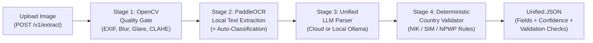

# MiruID (見るID)

[](https://github.com/Full-Stuck-Engineer/MiruID/actions/workflows/ci.yml)
[](LICENSE)
[](https://www.python.org/downloads/)

**Self-Hosted Universal ID Card Extraction & Validation Microservice**

> *Miru* (見る) — Japanese for **"to see, inspect, and read."**

**MiruID** is a privacy-first, Dockerized REST API that turns raw photos of national ID cards, driver's licenses, and tax cards into clean, validated JSON. Built with a pluggable 4-stage hybrid pipeline (**OpenCV Quality Gate + PaddleOCR + Unified LLM Parser + Deterministic Country Validators**), it ships with production-ready **Indonesian documents (e-KTP, SIM, NPWP)** and a clean plugin architecture for global expansion.

---

## Architecture

MiruID processes every uploaded document through a stateless, in-memory 4-stage pipeline:



- **Pluggable Extraction Modes (`EXTRACTION_MODE`):** Run in `hybrid` mode (PaddleOCR + structured LLM cleanup), `vision` mode (direct Vision-LLM), or `offline` mode (100% local PaddleOCR + deterministic regex fallback).
- **Auto-Detection:** Omit `country` and `doc_type` to let the heuristic classifier match OCR keywords against registered `DocumentPlugin` rules.
- **Clean Architecture:** Strict unidirectional dependencies across `app/domain/`, `app/application/`, `app/infrastructure/`, `app/api/`, and `app/plugins/`.

---

## Supported Documents

| Country | Document Type | Code (`country` / `doc_type`) | Deterministic Validation Rules |
| :--- | :--- | :--- | :--- |
| **Indonesia** | Electronic National ID (e-KTP) | `IDN` / `KTP` | 16-digit NIK format, valid province prefix, encoded birth date (including female `+40` day offset), and cross-check against extracted `date_of_birth` & `gender` |
| **Indonesia** | Driver's License (SIM) | `IDN` / `SIM` | 12–14 digit legacy & 16-digit (2024+ NIK-linked) SIM number formats, Perpol No. 5/2021 classes (`A`, `A UMUM`, `BI`, `BI UMUM`, `BII`, `BII UMUM`, `C`, `CI`, `CII`, `D`, `DI`), expiry & NIK cross-checks |
| **Indonesia** | Taxpayer ID Card (NPWP) | `IDN` / `NPWP` | Dual 15-digit (`XX.XXX.XXX.X-XXX.XXX`) & 16-digit (NIK-based individual / `0`-prefixed corporate) formats, 3-digit KPP tax office code extraction, and ISO registration date normalization |

Want to add a new country or document type? See [CONTRIBUTING.md](CONTRIBUTING.md).

---

## Quickstart

### Prerequisites

- Docker & Docker Compose (recommended), **or** Python 3.12+ with [`uv`](https://docs.astral.sh/uv/)

### Option A: Cloud LLM Provider (OpenAI / Gemini / Groq / OpenRouter)

1. Copy the environment template and configure any OpenAI-compatible endpoint:

```bash
cp .env.example .env
```

Edit `.env` with your provider credentials:

```dotenv
# Example: OpenAI
LLM_BASE_URL=https://api.openai.com/v1
LLM_API_KEY=sk-...
LLM_MODEL=gpt-4o-mini

# Example: Google Gemini (OpenAI-compatible endpoint)
# LLM_BASE_URL=https://generativelanguage.googleapis.com/v1beta/openai/
# LLM_API_KEY=AIza...
# LLM_MODEL=gemini-2.0-flash

# Example: Groq / OpenRouter
# LLM_BASE_URL=https://api.groq.com/openai/v1
# LLM_BASE_URL=https://openrouter.ai/api/v1
```

2. Build and start MiruID:

```bash
docker compose up --build
```

### Option B: Local Air-Gapped Ollama (100% On-Premise)

Run MiruID alongside a local Ollama container with zero external API calls:

```bash
cp .env.example .env
docker compose --profile local-llm up --build -d
```

Pull the default vision/structured model into the Ollama container:

```bash
docker exec -it miruid-ollama ollama pull qwen2.5vl:7b
```

### Interactive Playground UI

Enable the built-in web playground to test uploads and inspect structured JSON responses in your browser:

```dotenv
ENABLE_PLAYGROUND=true
```

Then open [http://localhost:8000/](http://localhost:8000/) (and Swagger OpenAPI docs at [http://localhost:8000/docs](http://localhost:8000/docs)).

---

## API Usage

### Health Check

```bash
curl -s http://localhost:8000/health | jq .
```

### List Supported Documents

```bash
curl -s http://localhost:8000/v1/documents | jq .
```

### Extract Document (Explicit `country` & `doc_type`)

```bash
curl -s -X POST http://localhost:8000/v1/extract \
  -H "X-Request-ID: demo-ktp-001" \
  -F "file=@/path/to/synthetic_ktp.jpg;type=image/jpeg" \
  -F "country=IDN" \
  -F "doc_type=KTP" | jq .
```

### Extract Document (Auto-Detect Country & Document Type)

Omit `country` and `doc_type` to automatically classify the uploaded document from OCR keywords:

```bash
curl -s -X POST http://localhost:8000/v1/extract \
  -F "file=@/path/to/synthetic_id.png;type=image/png" | jq .
```

---

## Configuration Reference (`.env`)

All configuration is managed via nested Pydantic settings in [`app/infrastructure/config.py`](app/infrastructure/config.py).

| Variable | Default | Description |
| :--- | :--- | :--- |
| **Core & Playground** | | |
| `APP_ENV` | `development` | Runtime environment (`development`, `staging`, `production`) |
| `SERVICE_NAME` | `miru-id` | Service name reported by `/health` and OpenAPI title |
| `APP_VERSION` *(or `VERSION`)* | `0.1.0` | Application version reported by `/health` |
| `LOG_LEVEL` | `INFO` | Structured JSON log level (`DEBUG`, `INFO`, `WARNING`, `ERROR`, `CRITICAL`) |
| `ENABLE_PLAYGROUND` | `false` | Mount the interactive Playground UI at `/` (`true` / `false`) |
| **HTTP API** | | |
| `API_HOST` | `0.0.0.0` | Bind host for the ASGI server |
| `API_PORT` | `8000` | Bind port for the ASGI server |
| `API_CORS_ORIGINS` | `["*"]` | JSON list of allowed CORS origins |
| `MAX_UPLOAD_SIZE_MB` *(or `API_MAX_UPLOAD_SIZE_MB`)* | `10` | Maximum uploaded image size in MB (`413` if exceeded) |
| `ALLOWED_MIME_TYPES` *(or `API_ALLOWED_MIME_TYPES`)* | `["image/jpeg","image/png","image/webp"]` | Accepted upload MIME types (`400` otherwise) |
| `EXTRACTION_MODE` *(or `API_EXTRACTION_MODE`)* | `hybrid` | Extraction strategy (`hybrid`, `vision`, `offline`) |
| **OpenCV Quality Gate** | | |
| `BLUR_THRESHOLD` *(or `MIN_BLUR_SCORE`)* | `100.0` | Minimum Laplacian variance sharpness score |
| `MIN_BRIGHTNESS` | `40.0` | Minimum acceptable grayscale mean brightness (`0`–`255`) |
| `MAX_BRIGHTNESS` | `220.0` | Maximum acceptable grayscale mean brightness (`0`–`255`) |
| `MAX_IMAGE_SIZE_MB` | `10` | Maximum decoded payload size in MB enforced by preprocessor |
| `MAX_IMAGE_DIM` | `1600` | Max width/height (px) before aspect-ratio-preserving downscale |
| `GLARE_PIXEL_RATIO_THRESHOLD` | `0.05` | Max ratio (`0.0`–`1.0`) of near-white pixels (`>= 250`) before flagging glare |
| `STRICT_QUALITY_GATE` | `true` | Reject blurry/low-quality images when `true` (`422`) |
| `APPLY_CLAHE` | `true` | Apply LAB L-channel CLAHE contrast normalization |
| **Local OCR (PaddleOCR)** | | |
| `OCR_ENABLED` | `true` | Enable local PaddleOCR engine initialization and startup warmup |
| `OCR_LANG` | `id` | PaddleOCR language model (`id`, `en`, `ch`, etc.) |
| `OCR_USE_ANGLE_CLS` | `true` | Enable text orientation / angle classification |
| `OCR_MIN_CONFIDENCE` | `0.5` | Minimum OCR line confidence threshold (`0.0`–`1.0`) |
| `OCR_MODEL_DIR` | *(empty)* | Optional path to pre-downloaded local OCR model weights |
| **Unified LLM Parser** | | |
| `LLM_BASE_URL` | `http://localhost:11434/v1` | OpenAI-compatible API base URL (Ollama, OpenAI, Gemini, Groq, OpenRouter) |
| `LLM_API_KEY` | *(empty)* | API key for cloud providers (leave empty for local Ollama) |
| `LLM_MODEL` | `qwen2.5vl:7b` | Model identifier used for structured extraction |
| `LLM_TIMEOUT_SECONDS` | `15.0` | Per-request LLM HTTP timeout in seconds |
| `LLM_MAX_RETRIES` | `2` | Maximum retries on transient LLM API failures |
| `LLM_TEMPERATURE` | `0.0` | Sampling temperature (`0.0`–`2.0`; `0.0` recommended for deterministic extraction) |

---

## Privacy & Security

MiruID is engineered for sensitive identity documents in regulated environments:

1. **Stateless In-Memory Processing:** Uploaded images are decoded directly from request bytes in memory (`bytes` -> OpenCV/NumPy arrays) and discarded immediately after the HTTP response is returned. Zero uploaded files or extracted PII are ever persisted to disk or a database.
2. **Read-Only Container Hardening:** The production Docker image runs as an unprivileged `appuser`, and `docker-compose.yml` mounts the container filesystem as `read_only: true` with a bounded 64 MB `/tmp` `tmpfs` mount.
3. **Automatic PII Log Redaction (`PiiMaskingFilter`):** Structured JSON logging attaches [`PiiMaskingFilter`](app/infrastructure/logging.py) across the root logger, stdout handler, and `uvicorn` loggers, automatically redacting sensitive identity numbers (such as 16-digit NIKs and NPWPs) from log messages and exception tracebacks.

---

## Synthetic Test Dataset

Never test or commit real government-issued ID card photos. MiruID includes a synthetic dataset generator (`scripts/generate_synthetic_ids.py`) to produce realistic, privacy-safe mock ID images (KTP, SIM, NPWP) with randomized synthetic data for local testing, benchmarking, and CI verification:

```bash
uv run python scripts/generate_synthetic_ids.py --output-dir /tmp/synthetic_ids
```

---

## Contributing

Contributions—especially new country `DocumentPlugin` implementations—are welcome! Read [CONTRIBUTING.md](CONTRIBUTING.md) for the plugin authoring guide, Clean Architecture rules, and local test commands.

## Author

- **Anthony Febrian** ([@anthonyfebrian](https://github.com/anthonyfebrian) / [@Full-Stuck-Engineer](https://github.com/Full-Stuck-Engineer)) — <anthony.febrian@gmail.com>

## License

This project is licensed under the Apache License 2.0 — see the [LICENSE](LICENSE) file for details.
